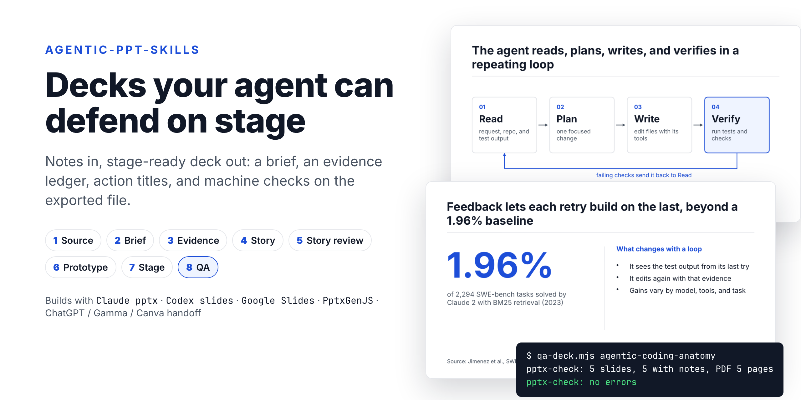
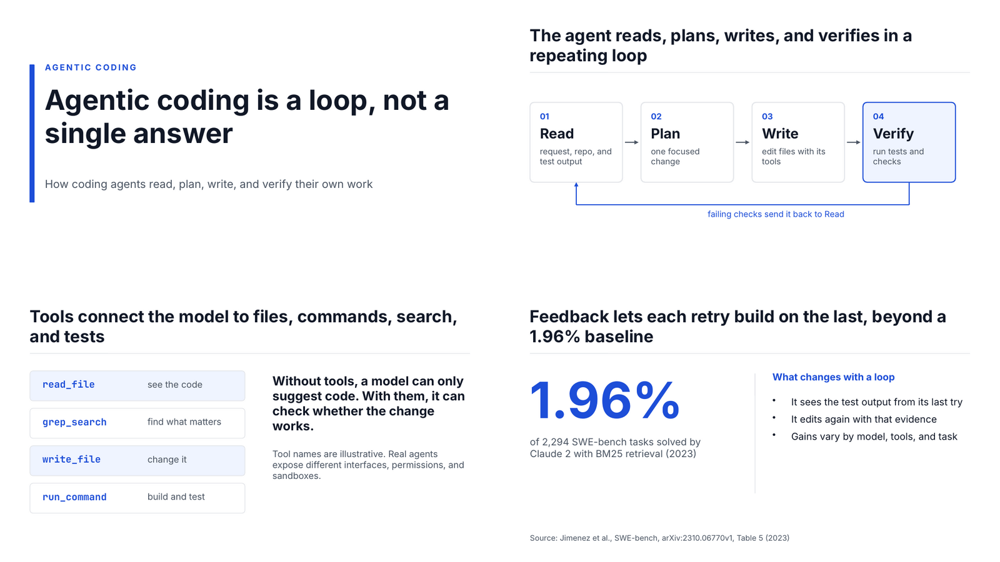

# agentic-ppt-skills

[English](./README.md) · [繁體中文](./README.zh-TW.md) · [简体中文](./README.zh-CN.md)

[](https://github.com/samulee003/agentic-ppt-skills/actions/workflows/test.yml)
[](./LICENSE)


**Agent skills that turn notes into a presentation you can defend on stage:
a real brief, sourced claims, slide titles that carry the argument, and
machine checks on the exported `.pptx`. Works with Claude, Codex, Google
Slides, PptxGenJS, and any tool you hand the slides to.**



## Why

Ask an agent for "a deck about X" and you usually get:

- slides with a title, a subtitle, and four bullet paragraphs each;
- numbers with no source, or with the wrong year and denominator;
- topic-label titles ("Results") that say nothing on their own;
- text that overflows its box, or shrinks until nobody can read it;
- speaker notes that are missing, or that don't match the slides.

This repository makes the agent work like a presentation team instead. It
writes a brief before any slide exists, keeps a ledger of every claim, plans
the talk slide by slide, builds a prototype before the full deck, rehearses it
as a talk, and only then exports. Scripts check the work at each step, so the
agent cannot just declare the deck done.

## Quick start

**Claude Code (plugin)**

```text
/plugin marketplace add samulee003/agentic-ppt-skills
/plugin install agentic-ppt-skills@agentic-ppt-skills
```

**Any agent (Claude Code, Codex, Cursor, …): one command in your project folder**

```bash
npx github:samulee003/agentic-ppt-skills                   # installs into .agents/
npx github:samulee003/agentic-ppt-skills --runtime=claude  # installs into .claude/
```

Then ask:

> Make a presentation from the notes in `./notes/`. It's a 15-minute decision
> deck for the leadership team.

Other ways to start: "Turn this PDF report into a 10-slide update", "Improve
`q3-review.pptx` and translate it to Traditional Chinese", "Build a 45-minute
workshop deck from these interview notes". Agents read [`AGENTS.md`](./AGENTS.md)
for the exact procedure.

## What you get

For each deck, in `presentation-work/<deck-id>/`:

| File | What it gives you |
| --- | --- |
| `PRESENTATION-BRIEF.md` | audience, decision, promise, success test, deck type, deliverables, theme |
| `EVIDENCE-LEDGER.md` | one row per claim with source, date, definition, caveat, and where it may be used; licences for every asset |
| `STORY.md`, `STORYBOARD.md` | thesis, chapters, and one row per slide: action title, layout archetype, evidence, time |
| `SPEAKER-SCRIPT.md` | what to say on every slide, timing, likely challenges, what to cut if short on time |
| `QA-REPORT.md` | check output, accessibility, inspected pages, remaining caveats |
| `exports/<deck-id>.pptx` / `.pdf` | the deck, with speaker notes on every slide |
| `STATUS.md` | which gates passed, with which artifacts and decisions |

## How it works

Eight gates, one focused skill each. The orchestrator always resumes from the
earliest gate that has not passed, and invalidates later gates when an earlier
decision changes.

| # | Gate | It answers | Checked by |
| --- | --- | --- | --- |
| 1 | Source intake | What material do we have, and which version is current? | |
| 2 | Brief | Who is this for, what should change, what is out of scope? | |
| 3 | Evidence | Which claims are safe to say, and with which caveats? | |
| 4 | Story | What does each slide have to do, in what order? | `storyboard-check.mjs` |
| 5 | Story review | Does it survive the strongest objection? Do the titles alone tell the story? | `storyboard-check.mjs` |
| 6 | Prototype | Do representative slides work in the real tool and theme? | `pptx-check.mjs` |
| 7 | Stage review | Can it be said aloud, on time, to this audience? | `unslop-check.mjs` |
| 8 | QA | Do the exported files match, read well, and pass every check? | `qa-deck.mjs` + `pptx-check.mjs` |

Three modes: `general`; `fast-track` for small internal decks (gates 1–2 and
4–5 are recorded together); and `research-enhanced` for decks with
consequential statistics, research, law, medicine, or finance (A/B/C/D claim
safety, primary sources, per-slide fact checks).

## Works with your slide tool

The pipeline decides what the deck says and whether it is ready. Any of these
can build the file, and all of them go through the same checks:

| You use | Engine | How the slides get built |
| --- | --- | --- |
| Claude (Claude Code, claude.ai) | `claude-pptx` | Claude's own `pptx` skill: native, editable `.pptx`, including from a brand template |
| Codex | `codex-slides` | the `slides` skill from [`openai/skills`](https://github.com/openai/skills) |
| Google Slides | `google-slides` | the Slides API or a Google Slides connector, or a `.pptx` imported into Slides |
| ChatGPT, Gamma, Canva, Copilot, Keynote, a designer | `handoff` | `build-packet.mjs` writes `BUILD-PACKET.md` for the tool; its exported `.pptx` comes back for QA |
| a plain script | `pptxgenjs` | a PptxGenJS `build.mjs` |
| an Office file whose master must survive | `genoffice` | the GenOffice CLI |
| a browser canvas / Markdown | `open-slide` / `marp` | their own CLIs |

Each engine has an adapter in [`adapters/`](./adapters/) with its authoring
rules, type-scale conversion, brand-template route, and QA steps.

## The checks

All scripts are zero-dependency Node 18+ and run on any engine's output.

| Script | Catches |
| --- | --- |
| `pptx-check.mjs` | missing speaker notes; slide, notes, and PDF page counts that disagree; text under the projector floor; text likely to overflow its box; pictures without alt text; text walls; image-only slides that can't be edited |
| `storyboard-check.mjs` | topic-label titles; missing or unknown layout archetypes; three identical layouts in a row; evidence IDs that are not in the ledger; a main talk longer than its slot |
| `theme-check.mjs` | theme colour pairs that fail WCAG AA contrast |
| `unslop-check.mjs` | AI-tell phrasing in slide copy and speaker notes |
| `qa-deck.mjs` | runs the engine's own audit, checks every export exists, then runs `pptx-check` |

An error from any check blocks its gate. On this repository's own example
deck, the overflow check found overlapping text that had shipped unnoticed;
it is fixed now.

```text
$ node .agents/skills/make-presentation/scripts/qa-deck.mjs agentic-coding-anatomy
pptx-check: 5 slides, 5 with notes, PDF 5 pages
pptx-check: no errors
```

## Example

[`examples/agentic-coding-anatomy-claude-pptx/`](./examples/agentic-coding-anatomy-claude-pptx/)
is a full run: the brief, ledger, story, and storyboard in
[`examples/agentic-coding-anatomy/work/`](./examples/agentic-coding-anatomy/work/),
built with the `claude-pptx` engine in the `editorial-minimal` theme.



The same story is also built with [Marp](./examples/agentic-coding-anatomy-marp/)
and [PptxGenJS](./examples/agentic-coding-anatomy-pptxgenjs/).

## Make it yours

- **Profiles** ([`profiles/`](./skills/make-presentation/profiles/)) bundle the
  defaults for a kind of work: `default`, or `training-zh-hant` for Traditional
  Chinese training with Cantonese delivery. Add your own.
- **Deck types** ([`deck-types.md`](./skills/make-presentation/references/deck-types.md)):
  `decision`, `update`, `pitch`, `training`, `keynote`, `technical`, each with
  a default structure; presenting and reading versions are separate deliverables.
- **Themes** ([`themes/`](./skills/make-presentation/themes/)):
  `editorial-minimal`, `bright-sans`, `aurora`, `sticker-pop`, each a
  contrast-checked rendering contract. A brand template overrides the palette
  and fonts.
- **One type scale** ([`typography.md`](./skills/make-presentation/references/typography.md))
  as a share of slide height, so the same floors hold on every engine.

## FAQ

**Do I need Claude?** No. The skills are plain Markdown plus Node scripts. Any
agent that reads `SKILL.md` files works; Codex reads `.agents/skills/` directly.

**Can I keep using ChatGPT, Gamma, or Canva for the slides?** Yes, with the
`handoff` engine. The agent prepares the brief, evidence, storyboard, and notes;
you paste `BUILD-PACKET.md` into the tool; the exported `.pptx` comes back for QA.
Tools that only export images cannot pass the notes and editability checks.

**Is it overkill for a 6-slide update?** Use `fast-track`. The gates still run,
but grilling is capped at one round and paired gates are recorded together.

**Does it work for Chinese decks?** Yes. CJK text gets its own density and
line-length rules, and the `training-zh-hant` profile covers Traditional Chinese
slides with Cantonese speaker notes.

**Can it fix a deck I already have?** Yes. Point it at the `.pptx`; it checks the
file first and treats the request as polish, rebrand, translate, or restructure
([`revise-existing.md`](./skills/make-presentation/references/revise-existing.md)).

## Repository layout

- `skills/`: the installable skills (orchestrator, eight gate skills, `genoffice`,
  and the grilling skills), with references, templates, themes, profiles, and scripts
- `adapters/`: one folder per engine
- `examples/`: complete runs
- `install.mjs`, `.claude-plugin/`: installers
- `.agents/`: the maintainers' own agent setup, not installed (see [`.agents/README.md`](./.agents/README.md))

## Credits

Shared practices (sharpen and playback, unslop, review buckets, prototype arena,
encode-lessons) are adapted from [`backnotprop/pstack`](https://github.com/backnotprop/pstack)
(MIT). Frontier-round grilling and the `grill-me`, `grilling`, and
`to-questionnaire` skills come from [`mattpocock/skills`](https://github.com/mattpocock/skills)
(MIT).

## Contributing

See [`CONTRIBUTING.md`](./CONTRIBUTING.md). Run the tests with:

```bash
npm test
```

## License

MIT. See [`LICENSE`](./LICENSE).
