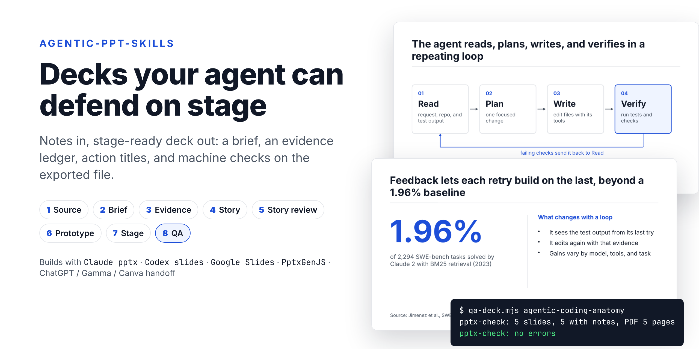
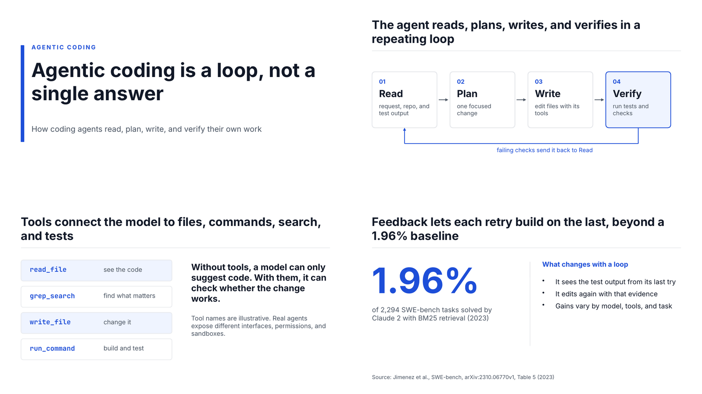

# agentic-ppt-skills

[English](./README.md) · [繁體中文](./README.zh-TW.md) · [简体中文](./README.zh-CN.md)

[](https://github.com/samulee003/agentic-ppt-skills/actions/workflows/test.yml)
[](./LICENSE)


**让 AI 代理把笔记做成“站得住脚”的演示文稿：先有需求书、每个论点有出处、标题本身就是论点，最后由程序检查导出的 `.pptx`。可搭配 Claude、Codex、Google 幻灯片、PptxGenJS，或交给任何你习惯的工具制作。**



## 为什么需要它

请 AI“做一份关于 X 的 PPT”，通常会得到：

- 每页都是标题、副标题加四段要点文字；
- 没有出处的数字，或年份、分母错误的数字；
- 像“成果”这种本身什么都没说的主题式标题；
- 文字溢出文本框，或被缩到没人看得清楚；
- 讲稿缺漏，或和幻灯片内容对不上。

这套技能让代理像一个演示团队那样工作：先写需求书、为每个论点建立证据表、逐页规划故事、先做原型再做整份、当成一场演讲来彩排，最后才导出。每一步都有程序检查，代理不能只靠自己说“做好了”。

## 快速开始

**Claude Code（插件）**

```text
/plugin marketplace add samulee003/agentic-ppt-skills
/plugin install agentic-ppt-skills@agentic-ppt-skills
```

**任何代理（Claude Code、Codex、Cursor……）：在项目文件夹执行一行命令**

```bash
npx github:samulee003/agentic-ppt-skills                   # 安装到 .agents/
npx github:samulee003/agentic-ppt-skills --runtime=claude  # 安装到 .claude/
```

接着直接说：

> 用 `./notes/` 里的笔记做一份演示文稿，给管理层看的 15 分钟决策汇报。

也可以这样开始：“把这份 PDF 报告做成 10 页的进度汇报”、“改进 `q3-review.pptx` 并翻成简体中文”、“用这些访谈记录做一份 45 分钟的工作坊课件”。代理会按 [`AGENTS.md`](./AGENTS.md) 的步骤执行。

## 你会得到什么

每份演示文稿都放在 `presentation-work/<deck-id>/`：

| 文件 | 内容 |
| --- | --- |
| `PRESENTATION-BRIEF.md` | 听众、要做的决定、承诺、验收标准、演示类型、交付物、主题 |
| `EVIDENCE-LEDGER.md` | 一个论点一行：出处、日期、定义、保留意见、可用在哪里；每个素材的授权 |
| `STORY.md`、`STORYBOARD.md` | 核心论点、章节，以及每页一行：结论式标题、版式、证据、时间 |
| `SPEAKER-SCRIPT.md` | 每页讲什么、时间、可能的质疑、时间不够时删哪里 |
| `QA-REPORT.md` | 检查结果、无障碍、看过哪些页、剩下的保留事项 |
| `exports/<deck-id>.pptx`／`.pdf` | 演示文稿本身，每页都有讲稿 |
| `STATUS.md` | 哪些关卡已通过，依据哪些产出与决定 |

## 运作方式

八道关卡，每关一个专门技能。协调器总是从最早未通过的关卡继续；前面的决定一改，后面的关卡会自动要求重审。

| # | 关卡 | 回答的问题 | 检查工具 |
| --- | --- | --- | --- |
| 1 | 来源盘点 | 有哪些资料？哪个版本是最新的？ | |
| 2 | 需求书 | 给谁看？要改变什么？哪些不做？ | |
| 3 | 证据 | 哪些话可以说？要加什么保留？ | |
| 4 | 故事 | 每一页要做什么？顺序是？ | `storyboard-check.mjs` |
| 5 | 故事审查 | 经得起最强的反对意见吗？只读标题能看懂吗？ | `storyboard-check.mjs` |
| 6 | 原型 | 代表页在实际工具和主题下行得通吗？ | `pptx-check.mjs` |
| 7 | 上台审查 | 讲得出口、时间对、适合这群听众吗？ | `unslop-check.mjs` |
| 8 | QA | 导出文件一致、好读、通过所有检查吗？ | `qa-deck.mjs` + `pptx-check.mjs` |

三种模式：`general`；给小型内部汇报的 `fast-track`（第 1–2 关、第 4–5 关合并记录）；以及内容涉及重要统计、研究、法律、医疗或金融时的 `research-enhanced`（A/B/C/D 论点安全等级、原始来源、逐页核查）。

## 搭配你的演示工具

流程负责决定演示文稿“说什么”与“能否上台”。下列任一工具都可以做出文件，全部都用同一套检查验收：

| 你使用 | 引擎 | 幻灯片怎么生成 |
| --- | --- | --- |
| Claude（Claude Code、claude.ai） | `claude-pptx` | Claude 原生的 `pptx` 技能：可编辑的原生 `.pptx`，也能套用品牌模板 |
| Codex | `codex-slides` | [`openai/skills`](https://github.com/openai/skills) 的 `slides` 技能 |
| Google 幻灯片 | `google-slides` | Slides API 或 Google 幻灯片连接器，或把 `.pptx` 导入 Google 幻灯片 |
| ChatGPT、Gamma、Canva、Copilot、Keynote、设计师 | `handoff` | `build-packet.mjs` 生成 `BUILD-PACKET.md` 交给该工具；导出的 `.pptx` 拿回来做 QA |
| 纯脚本 | `pptxgenjs` | PptxGenJS 的 `build.mjs` |
| 必须保留母版的 Office 文件 | `genoffice` | GenOffice CLI |
| 浏览器画布／Markdown | `open-slide`／`marp` | 各自的 CLI |

每个引擎在 [`adapters/`](./adapters/) 都有适配说明：制作规则、字号换算、品牌模板做法与 QA 步骤。

## 检查工具

所有脚本都零依赖、只需 Node 18+，可检查任何引擎的产出。

| 脚本 | 抓出的问题 |
| --- | --- |
| `pptx-check.mjs` | 缺讲稿；幻灯片、讲稿、PDF 页数不一致；字号低于投影下限；文字可能溢出文本框；图片缺替代文字；文字墙；整页是图片、无法编辑 |
| `storyboard-check.mjs` | 主题式标题；缺少或未知的版式；连续三页同版式；证据表里不存在的证据编号；主讲时间超过时段 |
| `theme-check.mjs` | 主题配色未达 WCAG AA 对比度 |
| `unslop-check.mjs` | 幻灯片文字与讲稿里的 AI 腔 |
| `qa-deck.mjs` | 运行引擎自己的检查、确认每个导出文件存在，再运行 `pptx-check` |

任何一项报错都会挡住该关卡。这个仓库自带的示例演示文稿，原本就有没人发现的文字重叠，是新的溢出检查第一次运行时抓到的，现已修正。

```text
$ node .agents/skills/make-presentation/scripts/qa-deck.mjs agentic-coding-anatomy
pptx-check: 5 slides, 5 with notes, PDF 5 pages
pptx-check: no errors
```

## 示例

[`examples/agentic-coding-anatomy-claude-pptx/`](./examples/agentic-coding-anatomy-claude-pptx/) 是完整的一次运行：需求书、证据表、故事与故事板在 [`examples/agentic-coding-anatomy/work/`](./examples/agentic-coding-anatomy/work/)，用 `claude-pptx` 引擎和 `editorial-minimal` 主题制作。



同一个故事也用 [Marp](./examples/agentic-coding-anatomy-marp/) 和 [PptxGenJS](./examples/agentic-coding-anatomy-pptxgenjs/) 各做了一份。

## 定制

- **配置档**（[`profiles/`](./skills/make-presentation/profiles/)）：把一类工作的默认值打包，例如 `default`，或繁体中文培训、粤语讲稿用的 `training-zh-hant`。可以自己新增。
- **演示类型**（[`deck-types.md`](./skills/make-presentation/references/deck-types.md)）：`decision`、`update`、`pitch`、`training`、`keynote`、`technical`，各有默认结构；演讲版与阅读版是分开的交付物。
- **主题**（[`themes/`](./skills/make-presentation/themes/)）：`editorial-minimal`、`bright-sans`、`aurora`、`sticker-pop`，每个都是经过对比度检查的呈现规格。品牌模板会覆盖配色与字体。
- **一套字号**（[`typography.md`](./skills/make-presentation/references/typography.md)）：以幻灯片高度的比例表示，所有引擎共用同样的下限。

## 常见问题

**一定要用 Claude 吗？** 不用。技能只是 Markdown 加 Node 脚本，任何会读 `SKILL.md` 的代理都能用；Codex 会直接读 `.agents/skills/`。

**可以继续用 ChatGPT、Gamma 或 Canva 做幻灯片吗？** 可以，用 `handoff` 引擎。代理准备好需求书、证据、故事板与讲稿，你把 `BUILD-PACKET.md` 贴进工具，导出的 `.pptx` 再拿回来 QA。只能导出图片的工具过不了讲稿与可编辑检查。

**6 页的进度汇报用这套会不会太重？** 用 `fast-track`。关卡照跑，但提问只问一轮，成对的关卡合并记录。

**中文演示文稿可以吗？** 可以。中日韩文字有自己的密度与行长规则；简体中文用 `default` 配置档即可，`training-zh-hant` 配置档则涵盖繁体中文幻灯片配粤语讲稿。

**可以修改我现有的演示文稿吗？** 可以。给它 `.pptx`，它会先检查文件，再把需求归类为润色、换品牌、翻译或重组（[`revise-existing.md`](./skills/make-presentation/references/revise-existing.md)）。

## 目录结构

- `skills/`：可安装的技能（协调器、八个关卡技能、`genoffice`、提问技能），含参考文档、模板、主题、配置档与脚本
- `adapters/`：每个引擎一个文件夹
- `examples/`：完整运行示例
- `install.mjs`、`.claude-plugin/`：安装方式
- `.agents/`：维护者自用的代理配置，不会被安装（见 [`.agents/README.md`](./.agents/README.md)）

## 致谢

共用实践（聚焦重放、去 AI 腔、审查分桶、原型擂台、经验编码）改编自 [`backnotprop/pstack`](https://github.com/backnotprop/pstack)（MIT）。轮次式提问与 `grill-me`、`grilling`、`to-questionnaire` 技能来自 [`mattpocock/skills`](https://github.com/mattpocock/skills)（MIT）。

## 参与贡献

见 [`CONTRIBUTING.md`](./CONTRIBUTING.md)。运行测试：

```bash
npm test
```

## 许可

MIT。详见 [`LICENSE`](./LICENSE)。
