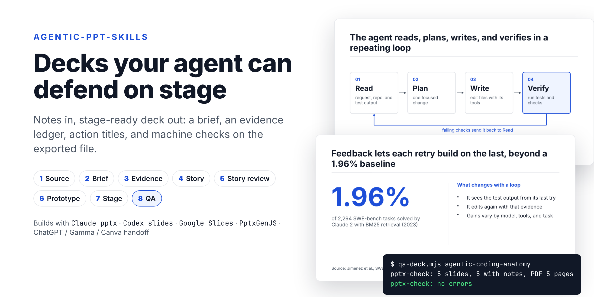
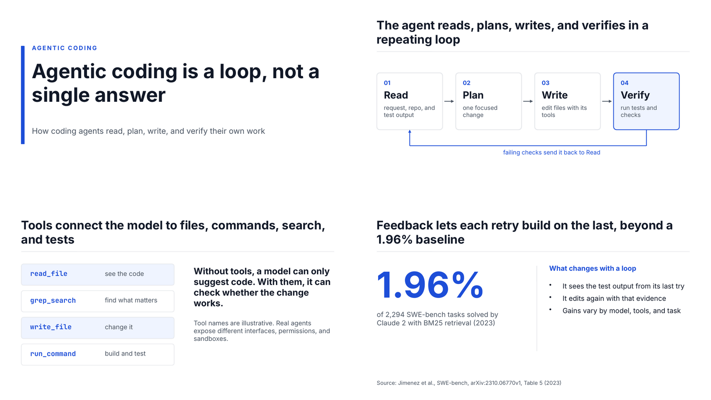

# agentic-ppt-skills

[English](./README.md) · [繁體中文](./README.zh-TW.md) · [简体中文](./README.zh-CN.md)

[](https://github.com/samulee003/agentic-ppt-skills/actions/workflows/test.yml)
[](./LICENSE)


**把 [grill-me](https://github.com/mattpocock/skills) 用在簡報上。** 在做出任何一頁投影片之前，AI 代理會先一輪一輪地盤問你：這份簡報給誰看、要改變什麼、哪些論點會被挑戰。接著由刁難型聽眾攻擊故事，只有拿得出證據的質疑才會留下。程式會檢查盤問確實做了，也會檢查匯出的 `.pptx` 經得起考驗。可搭配 Claude、Codex、Google 簡報、PptxGenJS，或交給任何你習慣的工具製作。



## 為什麼需要它

請 AI「做一份關於 X 的簡報」，它會立刻開始生成，從不問台下是誰、他們要做什麼決定、財務長會挑戰哪個數字。所以通常會得到：

- 每頁都是標題、副標題加四段條列文字；
- 沒有出處的數字，或年份、分母錯誤的數字；
- 像「成果」這種本身什麼都沒說的主題式標題；
- 文字溢出文字框，或被縮到沒人看得清楚；
- 講稿缺漏，或和投影片內容對不上。

這套技能讓代理像好的簡報教練一樣先問，而且在決定一場演講成敗的三個時刻持續追問：故事之前（這份簡報是為了什麼？）、故事之後（經得起最刁難的聽眾嗎？）、上台之前（講得出口、時間對、適合這群人嗎？）。每一步都有程式檢查，代理不能跳過提問，也不能自己宣布做好了。

## 三次盤問

**1. 需求書。** 代理依照一棵[決策樹](./skills/make-presentation/references/grill-tree.md)一輪一輪地問：所有前提已經確定的問題一次問完，每題附上建議答案，回「好」就採用。

```text
❓ Q1 - 簡報類型：這是技術說明，而不是決策簡報吧？
➡️ 是，技術說明：筆記在解釋機制，沒有要求任何決定。

❓ Q2 - 證據門檻：要談代理的評測數據嗎？
➡️ 要，但只用一個有原始出處的歷史基準。筆記裡「< 5% 對 30%+」的
   SWE-bench Lite 比較沒有出處，分母也不一致。
```

關鍵決定（聽眾、結果、承諾、證據門檻、限制、驗收標準）只要你在場就一定會問。`grill-check.mjs` 會在任何節點缺漏時擋住該關卡，並在關鍵決定仍只是代理的假設時擋住交付。

**2. 故事。** 依簡報類型挑出的刁難者（財務長、執行的人、資安審查者，以及一定會有的新手）攻擊故事板。每條質疑都必須逐字引用簡報內容並附上證據：證據表缺列、前後矛盾、檢查失敗、數字算不攏，或簡報裡沒有任何地方回答的問題。`interrogation-check.mjs` 會重新核對引文與證據編號，捏造的質疑會被丟掉。

| 刁難者 | 頁 | 引文 | 證據 | 判定 |
| --- | --- | --- | --- | --- |
| 資深審查者 | 4 | "Feedback lets each retry build on the last, beyond a 1.96% baseline" | `claim-02` 不允許任何數字上的提升；「beyond」可能被聽成有提升 | 保留，必須處理 → 已加上保留說明 |
| 新手 | 2 | "…verifies in a repeating loop" | 「迴圈什麼時候停？」 | 丟棄：講稿已回答 |

**3. 上台。** 開場、時間、最難的三個問題、語言，以及長時間演講的注意力重整，都在實際畫面與講稿上提問，並再做一輪刁難演練。

講完之後，可選的[復盤](./skills/make-presentation/references/retro.md)會盤問你現場發生了什麼，把重複出現的教訓變成新的提問、檢查或設定檔規則。

## 快速開始

**Claude Code（外掛）**

```text
/plugin marketplace add samulee003/agentic-ppt-skills
/plugin install agentic-ppt-skills@agentic-ppt-skills
```

**任何代理（Claude Code、Codex、Cursor……）：在專案資料夾執行一行指令**

```bash
npx github:samulee003/agentic-ppt-skills                   # 安裝到 .agents/
npx github:samulee003/agentic-ppt-skills --runtime=claude  # 安裝到 .claude/
```

接著直接說：

> 用 `./notes/` 裡的筆記做一份簡報，給管理層看的 15 分鐘決策簡報。

也可以這樣開始：「把這份 PDF 報告做成 10 頁的進度簡報」、「改善 `q3-review.pptx` 並翻成繁體中文」、「用這些訪談紀錄做一份 45 分鐘的工作坊簡報」。代理會依 [`AGENTS.md`](./AGENTS.md) 的步驟執行。

## 你會得到什麼

每份簡報都放在 `presentation-work/<deck-id>/`：

| 檔案 | 內容 |
| --- | --- |
| `PRESENTATION-BRIEF.md` | 聽眾、要做的決定、承諾、驗收標準、簡報類型、交付物、主題 |
| `EVIDENCE-LEDGER.md` | 一個論點一列：出處、日期、定義、保留意見、可用在哪裡；每個素材的授權 |
| `STORY.md`、`STORYBOARD.md` | 核心論點、章節，以及每頁一列：結論式標題、版型、證據、時間 |
| `SPEAKER-SCRIPT.md` | 每頁要講什麼、時間、可能的質疑、時間不夠時刪哪裡 |
| `GRILL-LOG.md` | 每個決定、由誰決定（你 `Decided` 或代理 `Assumed`），以及它會牽動什麼 |
| `INTERROGATION.md` | 刁難者、他們經過驗證的質疑，以及每條如何處理 |
| `QA-REPORT.md` | 檢查結果、無障礙、看過哪些頁、剩下的保留事項 |
| `exports/<deck-id>.pptx`／`.pdf` | 簡報本身，每頁都有講稿 |
| `STATUS.md` | 哪些關卡已通過，依據哪些產出與決定 |

## 運作方式

八道關卡，每關一個專門技能。協調器永遠從最早未通過的關卡繼續；前面的決定一改，後面的關卡會自動要求重審。

| # | 關卡 | 回答的問題 | 檢查工具 |
| --- | --- | --- | --- |
| 1 | 來源盤點 | 有哪些資料？哪個版本是最新的？ | `source-check.mjs` |
| 2 | 需求書 | 給誰看？要改變什麼？哪些不做？ | `grill-check.mjs` |
| 3 | 證據 | 哪些話可以說？要加什麼保留？ | `ledger-check.mjs` |
| 4 | 故事 | 每一頁要做什麼？順序是？ | `storyboard-check.mjs`、`ledger-check.mjs` |
| 5 | 故事審查 | 經得起最刁難的聽眾嗎？只讀標題能看懂嗎？ | `interrogation-check.mjs`、`grill-check.mjs` |
| 6 | 原型 | 代表頁在實際工具和主題下行得通嗎？ | `pptx-check.mjs` |
| 7 | 上台審查 | 講得出口、時間對、適合這群聽眾嗎？ | `interrogation-check.mjs`、`grill-check.mjs`、`unslop-check.mjs` |
| 8 | QA | 匯出檔一致、好讀、通過所有檢查嗎？每個關鍵決定都經你確認了嗎？ | `qa-deck.mjs`、`pptx-check.mjs`、`plan-check.mjs`、`grill-check.mjs` |

三種模式：`general`；給小型內部簡報的 `fast-track`（第 1–2 關、第 4–5 關合併記錄）；以及內容涉及重要統計、研究、法律、醫療或財務時的 `research-enhanced`（A/B/C/D 論點安全等級、原始來源、逐頁查證）。

## 搭配你的簡報工具

流程負責決定簡報「說什麼」與「能否上台」。下列任一工具都可以做出檔案，全部都用同一套檢查驗收：

| 你使用 | 引擎 | 投影片怎麼產生 |
| --- | --- | --- |
| Claude（Claude Code、claude.ai） | `claude-pptx` | Claude 原生的 `pptx` 技能：可編輯的原生 `.pptx`，也能套用品牌範本 |
| Codex | `codex-slides` | [`openai/skills`](https://github.com/openai/skills) 的 `slides` 技能 |
| Google 簡報 | `google-slides` | Slides API 或 Google 簡報連接器，或把 `.pptx` 匯入 Google 簡報 |
| ChatGPT、Gamma、Canva、Copilot、Keynote、設計師 | `handoff` | `build-packet.mjs` 產生 `BUILD-PACKET.md` 交給該工具；匯出的 `.pptx` 拿回來做 QA |
| 純腳本 | `pptxgenjs` | PptxGenJS 的 `build.mjs` |
| 必須保留母片的 Office 檔 | `genoffice` | GenOffice CLI |
| 瀏覽器畫布／Markdown | `open-slide`／`marp` | 各自的 CLI |

每個引擎在 [`adapters/`](./adapters/) 都有轉接說明：製作規則、字級換算、品牌範本做法與 QA 步驟。

## 檢查工具

所有腳本都零依賴、只需 Node 18+，可檢查任何引擎的產出。

| 腳本 | 抓出的問題 |
| --- | --- |
| `source-check.mjs` | 來源盤點表裡列了、實際卻不存在的檔案 |
| `ledger-check.mjs` | 沒有出處的論點（研究模式下還要有日期與安全等級）；主講頁引用有爭議（C）或已剔除（D）的論點；標題有數字卻沒附證據；素材沒記授權 |
| `plan-check.mjs` | 成品偏離計畫：頁數增減、結論式標題被改寫、核准的講稿被換掉（交接給外部工具時最常見） |
| `grill-check.mjs` | 沒人確定的決策節點；沒寫理由的假設；仍在等別人回覆的問題；只有代理自己決定的關鍵決定 |
| `interrogation-check.mjs` | 錯引簡報、引用不存在的證據編號或沒有證據的質疑；刁難者少於三位；必須處理卻未處理的質疑 |
| `pptx-check.mjs` | 缺講稿；投影片、講稿、PDF 頁數不一致；字小於投影下限；文字可能溢出文字框；圖片缺替代文字；文字牆；整頁是圖片、無法編輯 |
| `storyboard-check.mjs` | 主題式標題；缺少或未知的版型；連續三頁同版型；證據表裡不存在的證據編號；主講時間超過時段 |
| `theme-check.mjs` | 主題配色未達 WCAG AA 對比 |
| `unslop-check.mjs` | 投影片文字與講稿裡的 AI 腔 |
| `qa-deck.mjs` | 執行引擎自己的檢查、確認每個匯出檔存在，再跑 `pptx-check` |
| `status.mjs brief` | 不是檢查：回到簡報時顯示的接續摘要（進度、未決事項、下一步） |

任何一項報錯都會擋住該關卡。這個 repo 自帶的範例簡報，原本就有沒人發現的文字重疊，是新的溢出檢查第一次執行時抓到的，現已修正。

```text
$ node .agents/skills/make-presentation/scripts/qa-deck.mjs agentic-coding-anatomy
pptx-check: 5 slides, 5 with notes, PDF 5 pages
pptx-check: no errors
```

## 範例

[`examples/agentic-coding-anatomy-claude-pptx/`](./examples/agentic-coding-anatomy-claude-pptx/) 是完整的一次執行：需求書、證據表、故事與故事板在 [`examples/agentic-coding-anatomy/work/`](./examples/agentic-coding-anatomy/work/)，用 `claude-pptx` 引擎和 `editorial-minimal` 主題製作。



同一個故事也用 [Marp](./examples/agentic-coding-anatomy-marp/) 和 [PptxGenJS](./examples/agentic-coding-anatomy-pptxgenjs/) 各做了一份。

[`examples/simulated-training-zh-hant/`](./examples/simulated-training-zh-hant/) 是以模擬使用者完整跑一次的範例：45 分鐘的繁體中文工作坊，配粵語講稿，使用 `sticker-pop` 主題。它的[執行紀錄](./examples/simulated-training-zh-hant/RUN-LOG.md)列出這次模擬揭露的 8 個問題，以及各自的修正。

## 客製化

- **設定檔**（[`profiles/`](./skills/make-presentation/profiles/)）：把一類工作的預設打包起來，例如 `default`，或繁體中文培訓、粵語講稿用的 `training-zh-hant`。可以自己新增。
- **簡報類型**（[`deck-types.md`](./skills/make-presentation/references/deck-types.md)）：`decision`、`update`、`pitch`、`training`、`keynote`、`technical`，各有預設結構；上台版與閱讀版是分開的交付物。
- **主題**（[`themes/`](./skills/make-presentation/themes/)）：`editorial-minimal`、`bright-sans`、`aurora`、`sticker-pop`，每個都是經過對比檢查的呈現規格。品牌範本會覆蓋配色與字型。
- **一套字級**（[`typography.md`](./skills/make-presentation/references/typography.md)）：以投影片高度的比例表示，所有引擎共用同樣的下限。

## 常見問題

**一定要用 Claude 嗎？** 不用。技能只是 Markdown 加 Node 腳本，任何會讀 `SKILL.md` 的代理都能用；Codex 會直接讀 `.agents/skills/`。

**可以繼續用 ChatGPT、Gamma 或 Canva 做投影片嗎？** 可以，用 `handoff` 引擎。代理準備好需求書、證據、故事板與講稿，你把 `BUILD-PACKET.md` 貼進工具，匯出的 `.pptx` 再拿回來 QA。只能匯出圖片的工具過不了講稿與可編輯檢查。

**問題這麼多會不會拖慢速度？** 每一輪把能一起問的問題一次問完，並附上建議答案，一句「全部照建議，除了 Q3：……」就能解決大半。需求書通常兩、三輪就完成。你也可以說「一次問一題」或「別問了」；後者會讓代理把選擇記成假設，交付前要等你確認關鍵的那幾項。

**6 頁的進度報告用這套會不會太重？** 用 `fast-track`：每個盤問關卡只問一輪，但仍涵蓋所有關鍵決定，成對的關卡合併記錄。

**中文簡報可以嗎？** 可以。中日韓文字有自己的密度與行長規則，`training-zh-hant` 設定檔涵蓋繁體中文投影片配粵語講稿。

**可以修改我現有的簡報嗎？** 可以。給它 `.pptx`，它會先檢查檔案，再把需求歸類為潤飾、換品牌、翻譯或重組（[`revise-existing.md`](./skills/make-presentation/references/revise-existing.md)）。

## 目錄結構

- `skills/`：可安裝的技能（協調器、八個關卡技能、`genoffice`、提問技能），含參考文件、範本、主題、設定檔與腳本
- `adapters/`：每個引擎一個資料夾
- `examples/`：完整執行範例
- `install.mjs`、`.claude-plugin/`：安裝方式
- `.agents/`：維護者自用的代理設定，不會被安裝（見 [`.agents/README.md`](./.agents/README.md)）

## 致謝

盤問模型（在決策樹上一輪一輪地問、回「好」即採用建議）與 `grill-me`、`grilling`、`to-questionnaire` 技能來自 [`mattpocock/skills`](https://github.com/mattpocock/skills)（MIT）。需附證據的刁難演練、復盤、接續摘要、重述目標、去 AI 腔、審查分桶、原型擂台與經驗編碼，改編自 [`backnotprop/pstack`](https://github.com/backnotprop/pstack)（MIT）的 `interrogate`、`reflect`、`recall`、`in-your-own-words`、`unslop`、`arena` 與原則類技能。本專案自己的貢獻是簡報領域的部分：決策樹、各類簡報的刁難者、關卡與檢查工具。

## 參與貢獻

見 [`CONTRIBUTING.md`](./CONTRIBUTING.md)。執行測試：

```bash
npm test
```

## 授權

MIT。詳見 [`LICENSE`](./LICENSE)。
