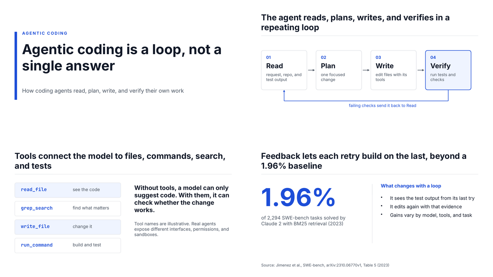

# Example: claude-pptx engine

The same story as [`../agentic-coding-anatomy/`](../agentic-coding-anatomy/README.md)
(gates 1–5 are shared: brief, evidence ledger, story, and storyboard live in
[`../agentic-coding-anatomy/work/`](../agentic-coding-anatomy/work/)), built with
the [`claude-pptx`](../../adapters/claude-pptx/README.md) adapter in the
[`editorial-minimal`](../../skills/make-presentation/themes/editorial-minimal.md) theme.



| File | What it is |
| --- | --- |
| [`slides/build.mjs`](./slides/build.mjs) | PptxGenJS source: one slide per storyboard row, action titles verbatim, notes on every slide |
| [`BUILD-PACKET.md`](./BUILD-PACKET.md) | what `build-packet.mjs` hands to an external tool for the same deck (the `handoff` engine) |
| [`exports/agentic-coding-anatomy.pptx`](./exports/agentic-coding-anatomy.pptx) | native, editable PowerPoint |
| [`exports/agentic-coding-anatomy.pdf`](./exports/agentic-coding-anatomy.pdf) | PDF converted with LibreOffice |
| [`images/`](./images/) | slide renders from the PDF |

## Rebuild and check

```bash
cd examples/agentic-coding-anatomy-claude-pptx/slides && npm install && cd ..
mkdir -p slides/agentic-coding-anatomy && cp slides/build.mjs slides/agentic-coding-anatomy/build.mjs
node ../../skills/make-presentation/scripts/qa-deck.mjs agentic-coding-anatomy --engine=claude-pptx --export
```

Final `qa-deck.mjs` output:

```text
pptx-check: 5 slides, 5 with notes, PDF 5 pages
pptx-check: no errors
```

## What the checks caught while building it

- The first build had a two-line hero title in a one-line box and three card
  headings that collided with the text under them. `pptx-check.mjs` reported
  each as "may overflow its box"; the boxes were resized.
- Slide 4 first carried 93 words. The density warning led to a shorter source
  line and tighter bullets (now under the limit, with the detail in the notes).
