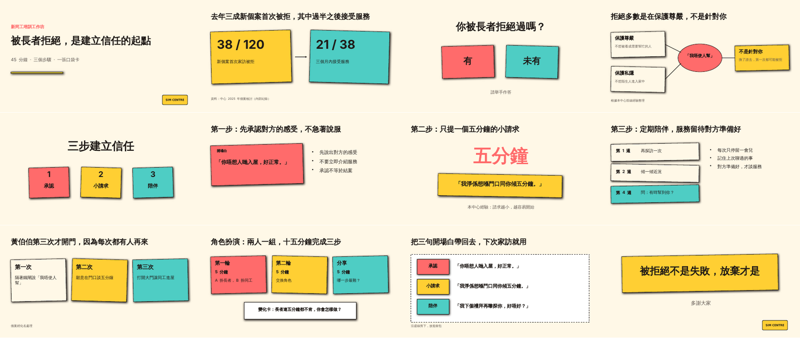

# Example: a simulated Traditional Chinese training workshop

A complete run of all eight gates with a **simulated** user, done to find where
the skills break. The persona (a supervisor at an elderly-services centre in
Macau), her answers, the case, the figures, and the logo are fictional. Read
[`RUN-LOG.md`](./RUN-LOG.md) first: it lists the eight problems the run found
and how each was fixed in the skills.



- **Deck:** 「長者拒絕服務時，怎樣建立信任」, a 45-minute workshop for new frontline staff
- **Profile:** `training-zh-hant` (written Chinese on slides, Cantonese speaker notes)
- **Engine and theme:** `claude-pptx`, `sticker-pop`

| Path | What it is |
| --- | --- |
| [`notes/`](./notes/) | the "user's" source: rough notes and the logo |
| [`presentation-work/refusal-trust-workshop/`](./presentation-work/refusal-trust-workshop/) | every gate's artifact: inventory, brief, grill log, ledger, story, storyboard, interrogation, speaker script, QA report, status |
| [`slides/refusal-trust-workshop/`](./slides/refusal-trust-workshop/) | `build.mjs` (PptxGenJS) and `notes.json` (Cantonese notes) |
| [`exports/`](./exports/) | the `.pptx` (13 slides, 13 notes) and `.pdf` |

## Check it yourself

From this folder:

```bash
node ../../skills/make-presentation/scripts/qa-deck.mjs refusal-trust-workshop
node ../../skills/make-presentation/scripts/status.mjs brief presentation-work/refusal-trust-workshop
```

To rebuild the deck: `npm install`, then
`node ../../skills/make-presentation/scripts/export-deck.mjs refusal-trust-workshop`.
